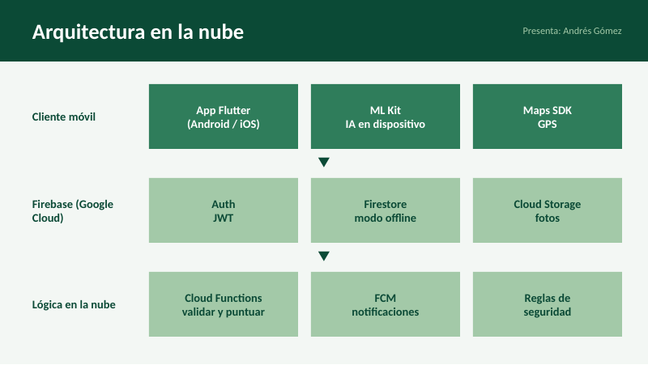
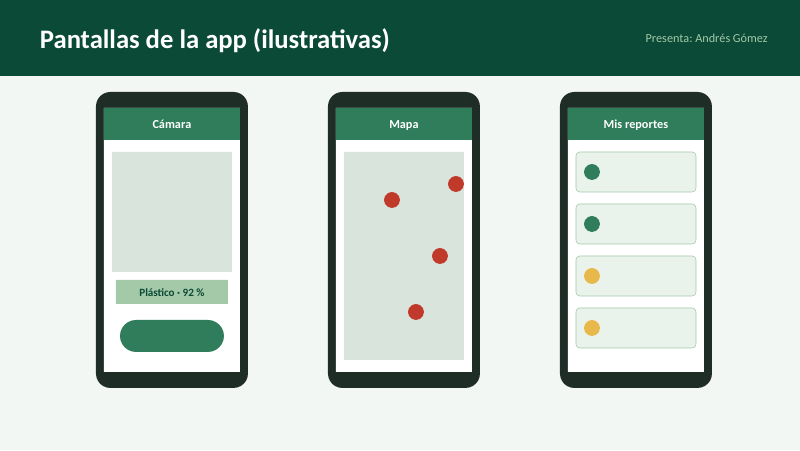

# EcoRuta ♻️

Aplicación móvil multiplataforma con clasificación de residuos mediante IA en el dispositivo y reporte georreferenciado para la gestión ambiental ciudadana.

**Curso:** Diseño de Aplicaciones Móviles · Facultad de Ingeniería y Ciencias Ambientales · Católica del Norte
**Integrantes:** Andrés Gómez · Daniel Rodríguez
**Metodología:** Design Thinking + Scrum ligero (sprints de 2 semanas)

## Problema y pregunta
Los residuos mal dispuestos contaminan calles y quebradas, la gente no sabe cómo disponer cada tipo y no existe un canal simple de reporte; además, la conectividad suele ser intermitente.

**Pregunta problema:** ¿De qué manera la implementación de una App Móvil basada en Flutter, Firebase y clasificación de imágenes en el dispositivo permite mejorar el reporte ciudadano y la correcta disposición de residuos en zonas con conectividad limitada?

## Objetivos SMART
- **General:** desarrollar en 8 semanas una app Flutter + Firebase que clasifique residuos con precisión ≥ 80 % y obtenga SUS ≥ 70 con 15 usuarios.
- **1. Diseño:** prototipo validado con 5 usuarios (semana 3).
- **2. Desarrollo:** módulos de cámara, clasificación, mapa y reportes con Firebase offline (semana 6).
- **3. Pruebas:** rendimiento, batería y usabilidad SUS en dispositivos reales (semana 8).

## Arquitectura


| Capa | Servicios |
|---|---|
| Cliente | Flutter (Android/iOS), ML Kit (IA en el dispositivo), GPS y Google Maps SDK |
| Firebase | Auth (JWT), Firestore con persistencia offline, Cloud Storage |
| Lógica en la nube | Cloud Functions (validar y puntuar reportes), FCM (notificaciones) |

Diagrama editable en [docs/arquitectura.md](docs/arquitectura.md) · [Costos](docs/costos.md) (USD 139 de 300) · [Seguridad](docs/seguridad.md)

## Estructura del repositorio
```
app/            Código Flutter (cámara, clasificación, reporte)
backend/        Reglas de Firestore y Storage, Cloud Functions
docs/           Arquitectura, costos, seguridad y evidencias
presentacion/   Diapositivas del proyecto (PPTX)
```

## Instrucciones de despliegue
1. Instalar Flutter 3.x y Firebase CLI (`npm i -g firebase-tools`).
2. Crear un proyecto en Firebase y activar Auth (anónimo), Firestore y Storage.
3. `cd app && flutter create . && dart pub global activate flutterfire_cli && flutterfire configure`
4. `cp .env.example .env` y completar las llaves (nunca subir `.env`).
5. Desde la raíz: `firebase deploy --only firestore:rules,storage,functions`
6. `cd app && flutter pub get && flutter run`

## Evidencias

### Prototipo de interfaz
Diseño de las tres pantallas principales (cámara con clasificación, mapa de reportes y lista de reportes). Es un esquema ilustrativo del diseño, no una captura de la app en ejecución.



### Estado del proyecto
| Entregable | Evidencia | Estado |
|---|---|---|
| Análisis del problema y objetivos | Este README y la presentación | Completo |
| Arquitectura en la nube | [arquitectura.png](docs/evidencias/arquitectura.png), [arquitectura.md](docs/arquitectura.md) | Completo |
| Código base de la app | [app/lib/main.dart](app/lib/main.dart) | Base lista (cámara, IA local, reporte) |
| Backend y seguridad | [firestore.rules](backend/firestore.rules), [storage.rules](backend/storage.rules), [index.js](backend/functions/index.js) | Completo |
| Costos y seguridad | [costos.md](docs/costos.md), [seguridad.md](docs/seguridad.md) | Completo |
| Presentación | [presentacion.pptx](presentacion/presentacion.pptx) | Completo |
| Pruebas en dispositivos reales y SUS | — | Siguiente fase (semanas 7 y 8) |

### Diapositivas
Imágenes de cada diapositiva en [docs/evidencias/diapositivas/](docs/evidencias/diapositivas/).

## Presentación
[presentacion/presentacion.pptx](presentacion/presentacion.pptx)
